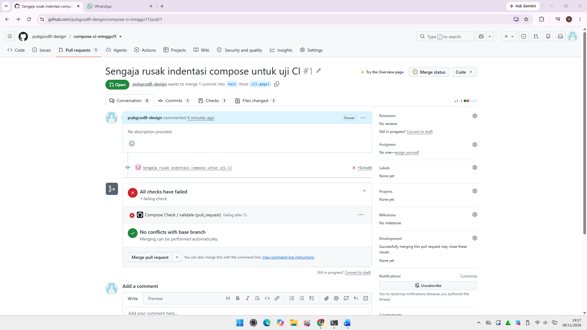
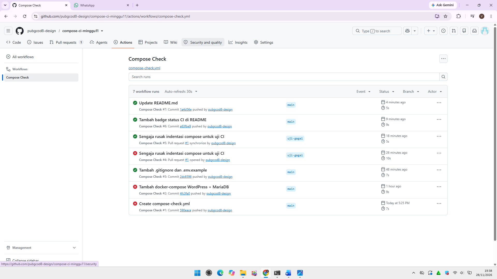

# compose-ci-minggu11

# Tugas Minggu 11: CI untuk Repo Compose
 

 
**Nama:** Joseph Ariel Prasetya
**NPM:** 202557201050 
**Mata kuliah:** Teknologi Open Source
 
## Deskripsi
Workflow ini memvalidasi sintaks file docker-compose.yml (stack
WordPress + MariaDB) dengan docker compose config -q, lalu
menjalankan stack sebentar sebagai uji tambahan. Workflow berjalan
setiap ada push ke branch main dan setiap ada Pull Request.
 
## Isi repositori
- .github/workflows/compose-check.yml : workflow CI
- docker-compose.yml : stack WordPress + MariaDB (tugas minggu 10)
- .env.example : contoh variabel lingkungan tanpa rahasia asli
- .gitignore : mengabaikan .env
 
## Cara kerja workflow
Pemicunya adalah push ke main dan pull_request. Ada satu job
bernama validate yang berjalan di ubuntu-latest dengan tiga step:
(1) checkout mengambil kode repositori ke runner, (2) .env.example
disalin menjadi .env karena .env asli tidak ada di repositori,
(3) docker compose config -q memeriksa sintaks file Compose. Tiga
step bonus menjalankan docker compose up -d, ps, lalu down.
 
## Bukti
1. Run hijau di tab Actions

2. Pull Request dengan check gagal (merah)

3. Badge status di README

 
Tautan Pull Request (sudah hijau dan di-merge):
https://github.com/pubgcod8-design/compose-ci-minggu11/pull/1
 
## Kendala dan cara mengatasinya
Pada Pull Request uji-gagal, log menampilkan "yaml: line 4:
mapping values are not allowed in this context" karena indentasi
image: pada service wordpress saya kurangi satu spasi. Pesan
menyebut baris 4. Setelah indentasi dikembalikan 
menjadi 4 spasi dan diuji dengan docker compose config -q, 
check berubah hijau.
 
## Refleksi singkat
CI membuat kesalahan pada file Compose ketahuan beberapa menit
setelah push. Pull Request yang merah harus diperbaiki dulu
sebelum digabung, sehingga branch main tetap sehat.
